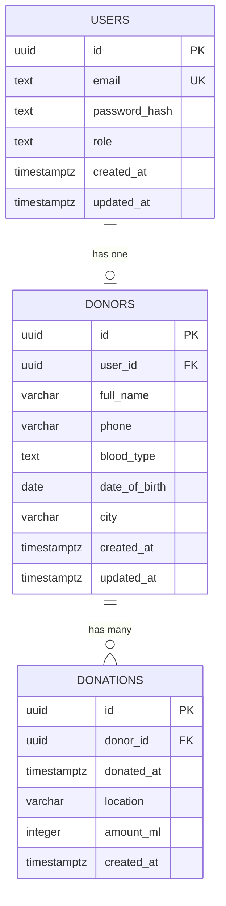

# Data Model — Neon Postgres

## Entity relationship

`users` → `donors` is one-to-one (`donors.user_id` UNIQUE + FK with `ON DELETE CASCADE`). `donors` → `donations` is one-to-many. Deleting a user removes the donor and its donation history.

## Tables

### users

| Column | Type | Constraints | Purpose |
| --- | --- | --- | --- |
| `id` | UUID | PK, default `gen_random_uuid()` | JWT subject |
| `email` | TEXT | NOT NULL, UNIQUE | Login identifier, stored lower-case |
| `password_hash` | TEXT | NOT NULL | bcrypt hash (cost 12), never returned by the API |
| `role` | TEXT | NOT NULL, default `donor`, CHECK in (`donor`,`staff`,`admin`) | Future authorisation |
| `created_at` | TIMESTAMPTZ | default `now()` | Audit |
| `updated_at` | TIMESTAMPTZ | default `now()` | Audit |

### donors

| Column | Type | Constraints | Purpose |
| --- | --- | --- | --- |
| `id` | UUID | PK | Public donor ID used by Booking/check-in |
| `user_id` | UUID | UNIQUE FK → users.id | Links identity to profile |
| `full_name` | VARCHAR(100) | NOT NULL | Display name |
| `phone` | VARCHAR(30) | nullable | Contact |
| `blood_type` | TEXT | CHECK in eight ABO/Rh values | Profile field |
| `date_of_birth` | DATE | nullable | Profile field |
| `city` | VARCHAR(100) | nullable | Profile field |
| `created_at`, `updated_at` | TIMESTAMPTZ | default `now()` | Audit |

### donations

| Column | Type | Constraints | Purpose |
| --- | --- | --- | --- |
| `id` | UUID | PK | Donation ID |
| `donor_id` | UUID | FK → donors.id | Owner of the record |
| `donated_at` | TIMESTAMPTZ | NOT NULL, default `now()` | Basis of the 56-day calculation |
| `location` | VARCHAR(120) | nullable | Where check-in happened |
| `amount_ml` | INTEGER | NOT NULL, default 450, CHECK 200–500 | Donation volume |
| `created_at` | TIMESTAMPTZ | default `now()` | When the row was inserted |

Indexes: `users_email_idx` on `users(email)` for login lookups; `donations_donor_donated_at_idx` on `(donor_id, donated_at DESC)` for last-donation and history queries.

## Create / Read / Update / Delete / Search operations

| Service function | CRUD/S | SQL operation |
| --- | --- | --- |
| `emailExists` | Read/Search | `SELECT 1 FROM users WHERE lower(email) = lower($1)` |
| `createUserWithDonor` | Create | Single CTE statement: `INSERT users` + `INSERT donors ... SELECT FROM new_user` + `SELECT` joined row with `RETURNING`; atomic, no partial accounts |
| `findUserByEmail` | Read | `SELECT id, email, password_hash, role, created_at ... LIMIT 1` |
| `findIdentityByUserId` | Read | `JOIN users/donors WHERE u.id = $1` |
| `findIdentityByDonorId` | Read | `JOIN users/donors WHERE d.id = $1` |
| `updateDonorProfile` | Update | `UPDATE donors SET ... WHERE id = $1 RETURNING ...` |
| `listDonations` | Read/Search | `SELECT ... WHERE donor_id = $1 ORDER BY donated_at DESC LIMIT 100` |
| `getLastDonation` | Read | `SELECT donated_at ... ORDER BY donated_at DESC LIMIT 1` |
| `getLastDonationBefore` | Read/Search | `SELECT donated_at ... WHERE donor_id = $1 AND donated_at <= $2 ORDER BY donated_at DESC LIMIT 1` |
| `insertDonation` | Create | `INSERT INTO donations ... RETURNING ...` |
| `checkDatabase` | Read | `SELECT 1 AS ok` |

Delete is available at the database level through the foreign-key cascade but is intentionally not exposed by an API endpoint in this component.

## Query design notes

- Every value is passed as a tagged-template parameter (`sql\`... ${value} ...\``), so user input is never concatenated into SQL text.
- `RETURNING` gives the API the database-generated UUID and timestamps in one round trip.
- `lower(email)` on both sides makes login case-insensitive while the unique index still prevents duplicates.
- Neon returns `created_at` as `createdAt` using column aliases, so the JSON contract stays camelCase while the database uses snake_case.
- `getLastDonationBefore` exists for backdated check-in records: the "previous donation" must be the newest donation **at or before** the recorded timestamp.
- The CHECK constraints repeat server validation inside the database so a bug or direct SQL write cannot store an invalid blood type or amount.
