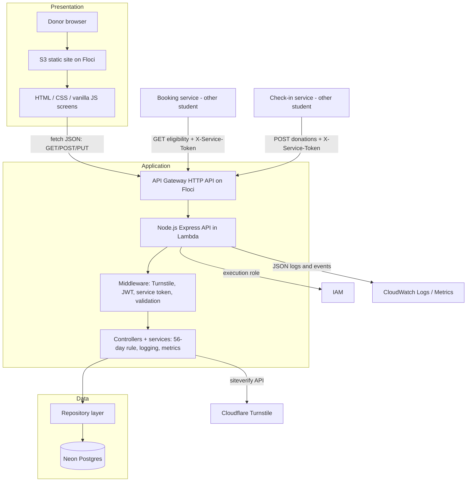
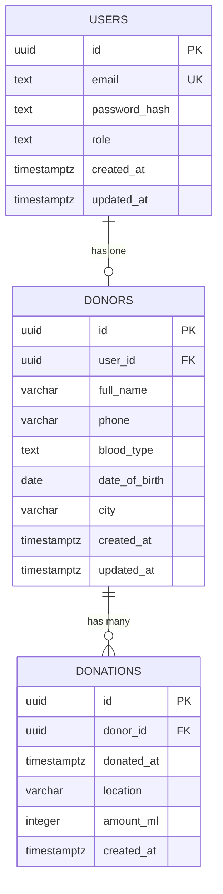

# Individual Contribution — Authentication, Identity, Eligibility, Logging and Monitoring

**Student:** `[YOUR NAME]`  
**Service owned:** Blood Donation Authentication and Identity Service  
**Scope:** This document describes **one student's part only**. The other two team services (Booking and Check-in) are mentioned only where they call this service. It does not define their functionality, code or internal design.

---

## 1. Scope, problem definition and business capability

### Target users
- Donors who need to register, log in, maintain a profile and see whether they can donate again.
- Staff/kiosk services that need to check eligibility and record a completed donation.
- Module staff/monitors who need health, readiness and metrics information.

### Problem
A blood donation system must know **who the donor is** and **whether the donor is allowed to donate**. Without a trusted identity and eligibility service, Booking could confirm appointments for ineligible donors, and check-in could record donations that violate the 56-day donation interval. Passwords must never be stored in plain text, and automated bots must not be able to create accounts or stuff credentials.

### Scope of this one service
This student owns one coherent business capability: **donor identity and eligibility**, with operational monitoring. All functions below are related to that capability:

1. Secure identity lifecycle — register, log in, read/update profile.
2. Eligibility and donation-history logic — calculate next eligible date and enforce the 56-day rule.
3. Observability and protection — structured logs, health/readiness/metrics, bot check, validation, rate limiting and security headers.

This is **not a CRUD-only service**. It applies real business rules (password hashing, bot verification, JWT identity checks, 56-day eligibility, backdated-donation handling and donation limits). It also communicates with other services through documented internal HTTP endpoints.

---

## 2. Three-layer architecture

| Layer | Files/components in this part | Responsibility |
| --- | --- | --- |
| Presentation | `frontend/index.html`, `frontend/css/styles.css`, `frontend/js/app.js`, `frontend/js/config.js`, `frontend/vercel.json` | Four screens: register/login, profile, eligibility banner, donation history. Sends HTTP requests and renders only server data. |
| Application / service | `backend/app.js`, `backend/server.js`, `backend/config.js`, `backend/routes/`, `backend/controllers/`, `backend/services/`, `backend/middleware/`, `backend/utils/` | Validation, Turnstile verification, bcrypt hashing, JWT issue/verify, eligibility calculation, donation checks, logging, metrics, error handling, CORS and rate limiting. |
| Data | `backend/db/schema.sql`, `backend/db/neon.js`, `backend/repositories/authRepository.js`, Neon Postgres tables | Persistent `users`, `donors` and `donations` data. The repository isolates all SQL from the controllers. |

### Architecture diagram including cloud services and external API



### Cloud model and justification
The deployment model is **serverless/PaaS**, not a manually managed VM:

- **API Gateway + Lambda** remove server administration and scale with HTTP traffic.
- **S3** serves the static frontend cheaply and separately from the API.
- **IAM** gives the Lambda function only the permissions it needs.
- **CloudWatch** stores the structured logs emitted by the service.
- **Neon** provides managed Postgres with a pooled connection string and no database server to patch.
- **Cloudflare Turnstile** is the external bot-protection API.

This suits a small coursework system because free/low-cost tiers are enough, secrets stay in environment variables/IAM, and the same code can also run locally with Docker.

---

## 3. Three meaningful functionalities owned by this student

### Function 1 — Secure identity lifecycle
- `POST /register` creates a `users` row with a bcrypt hash and a linked `donors` row in one database CTE, then issues a JWT.
- `POST /login` verifies the password with bcrypt and issues a JWT.
- `GET /me` and `PUT /profile` read and update the authenticated donor's profile.
- Every register/login request must first pass Cloudflare Turnstile server-side verification.
- A missing Turnstile secret fails closed with 500; a missing or failed token returns 403.
- JWTs contain `sub`, `email`, `donorId` and `role`, with expiry, issuer and audience checks. Each protected request also reloads the identity from Neon so a deleted account cannot keep using an old token.

**Business logic, not CRUD:** salted slow hashing, bot prevention, token identity checks, duplicate-email handling and strict input validation.

### Function 2 — Eligibility and donation-history logic
- `GET /eligibility` returns `eligible`, `reason`, `nextEligibleDate`, `daysRemaining` and `lastDonatedAt`.
- The next eligible date is calculated as `last donation + 56 days` using UTC arithmetic; partial days are rounded up.
- `POST /donations` re-checks eligibility before inserting a donation, so a donor cannot donate twice inside the window.
- `getLastDonationBefore(donorId, timestamp)` is used for backdated check-in records, so a newer donation does not incorrectly block a historical one.
- `GET /donations` returns the donor's history sorted newest first.
- `GET /donors/:donorId/eligibility` lets Booking check eligibility with a service token.

**Business logic, not CRUD:** a pure eligibility function reused by the donor banner, Booking and check-in; 56-day enforcement; backdated-record handling; amount range 200–500 ml; future dates rejected.

### Function 3 — Observability and protection
- `GET /health` for liveness, `GET /ready` for Neon connectivity, `GET /metrics` for protected counters.
- Every response emits one JSON log line with request ID, method, path, status, duration and user/service identity.
- Named events include `user_registered`, `user_logged_in`, `login_failed`, `eligibility_checked`, `donation_recorded`, `donation_rejected`, `turnstile_rejected` and `database_unavailable`.
- Helmet security headers, CORS allow-list, 16 kb JSON body limit, rate limiting on register/login, standard error shape and central error handling.

**Business logic, not CRUD:** monitoring decisions, failure classification, request tracing and abuse controls.

---

## 4. Internal and external HTTP requests

Base URL: `https://<api-domain>/api/auth` in the cloud, `http://localhost:3000/api/auth` locally.

All bodies are JSON. Timestamps are ISO 8601 UTC. IDs are UUIDs. Every response includes `X-Request-Id`.

| # | Method | Path | Auth | Request data | Success | Key errors |
| --- | --- | --- | --- | --- | --- | --- |
| 1 | POST | `/register` | Turnstile token | `fullName`, `email`, `password`, optional `phone`, `bloodType`, `dateOfBirth`, `city` | 201 JWT + user + donor | 400 validation, 403 bot check, 409 duplicate email, 429 rate limit |
| 2 | POST | `/login` | Turnstile token | `email`, `password` | 200 JWT + profile | 400 validation, 403 bot check, 401 invalid credentials |
| 3 | GET | `/me` | Bearer JWT | none | 200 user + donor | 401 unauthorised, 404 identity missing |
| 4 | PUT | `/profile` | Bearer JWT | at least one of `fullName`, `phone`, `bloodType`, `dateOfBirth`, `city` | 200 updated profile | 400 validation, 401 unauthorised |
| 5 | GET | `/eligibility` | Bearer JWT | none | 200 eligibility object | 401 unauthorised |
| 6 | GET | `/donations` | Bearer JWT | none | 200 `{ donorId, count, donations }` | 401 unauthorised |
| 7 | POST | `/donations` | Bearer JWT or service token | `donatedAt?`, `location?`, `amountMl`, plus `donorId` for service calls | 201 donation | 400 validation, 409 not eligible |
| 8 | GET | `/donors/:donorId/eligibility` | Service token | `donorId` in path | 200 same eligibility object | 400 invalid UUID, 401 bad service token, 404 donor missing |
| 9 | GET | `/health` | none | none | 200 `{ status:"ok", ... }` | — |
| 10 | GET | `/ready` | none | none | 200 `{ status:"ready", database:"ok" }` | 503 database unavailable |
| 11 | GET | `/metrics` | Metrics token | none | 200 counters | 403 forbidden |

**Method choice:** GET is used for idempotent reads, POST for creating resources or triggering actions, and PUT for a full profile update. A DELETE endpoint is deliberately not exposed because donor identity and donation history must be retained for audit; deletion is handled only by database cascade if an account is removed by an authorised team process.

Example eligibility response:

```json
{
  "donorId": "27fb8428-74f0-4984-8d60-4fbfc7c831bb",
  "eligible": false,
  "reason": "WAITING_PERIOD",
  "lastDonatedAt": "2026-11-13T10:00:00.000Z",
  "nextEligibleDate": "2027-01-08T10:00:00.000Z",
  "daysRemaining": 46
}
```

Example standard error:

```json
{
  "error": {
    "code": "NOT_ELIGIBLE",
    "message": "Donor is not eligible yet.",
    "details": { "nextEligibleDate": "2027-01-08T10:00:00.000Z", "daysRemaining": 46 }
  }
}
```

Evidence: `[API ROOT SCREENSHOT]`, `[POSTMAN REGISTER 201]`, `[POSTMAN LOGIN 200]`, `[POSTMAN ELIGIBILITY 200]`, `[POSTMAN 409 NOT ELIGIBLE]`, `[NETWORK TAB SCREENSHOT]`.

---

## 5. Database operations and ownership

Database: **Neon Postgres**, database `neondb`, branch `production`.

### Entity relationship



**Ownership:** all three tables are owned by this service. Booking and Check-in do not own tables; they call this service's HTTP endpoints using `donorId` and the shared service token.

| Operation | Implementation | Used by |
| --- | --- | --- |
| Create | `INSERT ... RETURNING` for user+donor in one CTE; `INSERT ... RETURNING` for donations | register, check-in |
| Read | lookup by lower-case email, identity by user/donor ID, last donation, full history | login, `/me`, eligibility, history |
| Update | `UPDATE donors ... RETURNING` | `PUT /profile` |
| Delete | `ON DELETE CASCADE` in schema; no public delete endpoint | account removal process |
| Search | `emailExists`, `findUserByEmail`, `getLastDonation`, `getLastDonationBefore` | register, login, eligibility, backdated check-in |

Indexes: `users_email_idx` for login lookups and `donations_donor_donated_at_idx` for last-donation/history queries.

Evidence: `[NEON TABLES SCREENSHOT]`, `[NEON USERS ROW]`, `[NEON DONATIONS ROW]`, `backend/db/schema.sql`, `backend/repositories/authRepository.js`.

---

## 6. External service with a real job

**Cloudflare Turnstile** is not decorative. It sits on the trust boundary of register and login:

1. The frontend renders the Turnstile widget and sends the token in `X-Turnstile-Token`.
2. The backend calls `https://challenges.cloudflare.com/turnstile/v0/siteverify`.
3. A missing or failed token returns 403 **before** any password check or database write.
4. This blocks automated account creation and credential-stuffing attempts against the API.

Local development uses the official test keys (`1x00000000000000000000AA` / `1x0000000000000000000000000000000AA`) and dummy token `XXXX.DUMMY.TOKEN.XXXX`. Production requires a real widget whose **Allowed hostname** is the deployed frontend hostname without `https://` or a path.

Additional cloud services: **Neon** persists all data; **CloudWatch** stores logs and events; **S3** hosts the static frontend on Floci.

Evidence: `[CLOUDFLARE WIDGET SCREENSHOT]`, `[TURNSTILE 403 SCREENSHOT]`, `[CLOUDFLARE WIDGET SETTINGS SCREENSHOT]`.

---

## 7. Frontend work — no hard-coded data

The frontend is plain HTML, CSS and JavaScript — no React and no hard-coded donor records.

- `index.html` contains the four screens: login/register with tabs, profile, eligibility banner and donation history table.
- `js/app.js` calls the API, stores the JWT in `sessionStorage`, attaches `Authorization: Bearer ...`, renders server responses with `textContent`, and shows confirmations/errors.
- `js/config.js` contains only the API base URL and public Turnstile site key, not data.
- The eligibility banner changes from green to amber using the `eligible` and `daysRemaining` values returned by the backend.
- The donation history table is built only from `GET /donations`.
- Logout clears the session; subsequent protected calls fail with 401 as expected.
- `vercel.json` contains a strict CSP that still allows Cloudflare's script/frame for the widget.

Evidence: `[LOGIN SCREEN]`, `[REGISTER SCREEN]`, `[PROFILE SCREEN]`, `[ELIGIBILITY ELIGIBLE]`, `[ELIGIBILITY WAITING]`, `[DONATION HISTORY]`, `[LOGOUT SCREEN]`.

---

## 8. Input validation, error handling and secret management

- Server-side validation rejects invalid email, short/weak passwords, invalid names/phones, unsupported blood types, bad dates, invalid donor UUIDs, future donation dates and amounts outside 200–500 ml.
- Frontend validation is convenience only; the API always validates again.
- Errors use one shape: `{ error: { code, message, details? } }`.
- Status codes include 200, 201, 400, 401, 403, 404, 409, 413, 429, 500 and 503.
- Malformed JSON becomes 400; oversized bodies become 413.
- Passwords, JWTs, Turnstile tokens and connection strings are never logged.
- `.env` and `.env.*` are gitignored. Secrets are supplied through environment variables in Lambda/Vercel and `backend/.env` locally. Docker receives them through Compose `env_file`; they are not copied into images.
- Helmet, CORS allow-listing, rate limiting and strict CSP add further protection.

Evidence: `[400 VALIDATION]`, `[403 BOT CHECK]`, `[401 INVALID CREDENTIALS]`, `[404 UNKNOWN ROUTE]`, `[CSP HEADERS]`, `.gitignore`.

---

## 9. Integration with the other two students

This service does not isolate itself; it exposes shared contracts:

- **Booking** calls `GET /api/auth/donors/{donorId}/eligibility` with `X-Service-Token` before confirming an appointment. It uses the same eligibility result as the donor banner.
- **Check-in** calls `POST /api/auth/donations` with `X-Service-Token`, `donorId`, `donatedAt`, `location` and `amountMl`. The service re-checks eligibility and returns 201 or 409.
- All callers use the same `donorId` UUID and the same 56-day calculation, so the three paths cannot disagree.
- `docs/integration.md` documents headers, request bodies, success responses and error cases.

The other students' services are not specified here; only these call points belong to this student's evidence.

Evidence: `[BOOKING CALL 200]`, `[CHECK-IN CALL 201]`, `[SERVICE TOKEN FAILURE 401]`, `docs/integration.md`.

---

## 10. Testing, results and limitations

### Automated tests
`npm test` → **34 tests, 34 pass, 0 fail**.

Coverage includes:
- HTTP tests with an injected fake repository: health, readiness, register, login, profile, eligibility, history, donation recording, service-auth endpoints, metrics and error cases.
- Unit tests for the pure eligibility function: no history, 55 days, exactly 56 days, configurable interval and rounded-up days remaining.

### Build and integration proof
- `npm run build` → `Build validation passed: backend JS, frontend JS, JSON, Neon config and required files.`
- Real Neon schema applied → `Tables verified: donations, donors, users`.
- Direct catalog check → 1 user, 1 donor, 3 donation rows after the end-to-end run.
- End-to-end run against the real API and Neon → **16/16 checks passed**, including register, login, profile, eligibility before/after donations, 56-day block with 409, history, Booking service call, Check-in donation and protected metrics.
- Docker Compose → both containers healthy; the same 16 end-to-end checks passed against the containerized API.

### Manual evidence still to attach
`docs/test-plan.md` contains 36 API/browser/cloud cases with expected results. Attach actual responses and screenshots for: `[A01]–[A36]`, `[B01]–[B07]`, `[C01]–[C05]`.

### Limitations
| Limitation | Impact | Mitigation |
| --- | --- | --- |
| Local Turnstile uses public test keys | Always passes; does not prove real hostname validation | Add the deployed hostname in Cloudflare and retest with real keys |
| Metrics counters are in memory | Reset on Lambda/container restart | Use CloudWatch Metrics/Logs for long-term monitoring |
| Automated HTTP tests use a fake repository | Do not prove Neon concurrency | Real Neon end-to-end run and direct catalog check were also performed |
| No load/concurrency test | Throughput limits not measured | Use API Gateway/Lambda scaling and rate limiting; add load testing later |
| Floci deployment not executed in this workspace | Deployment marks require emulator evidence | Follow Section 11 and attach Floci screenshots |
| No real production Turnstile hostname yet | Production widget cannot be finalised | Add hostname after frontend deployment, then retest register/login |

---

## 11. Deployment on Floci / AWS emulator

**Current status:** the code has been proven on Vercel + Neon, which the brief treats as the minimum submission and loses deployment marks. To gain the deployment marks, this service must be deployed on **Floci or an equivalent AWS emulator** with at least **three AWS services owned by this student**. The mapping below satisfies that with five.

### AWS services used by this student's component

| AWS service on Floci | How this service uses it | Evidence to attach |
| --- | --- | --- |
| 1. API Gateway | HTTP API exposing `/api/auth/*` to the frontend and other services | `[APIGW ROUTES SCREENSHOT]` |
| 2. Lambda | Runs the Node.js/Express API exported from `backend/server.js` | `[LAMBDA FUNCTION SCREENSHOT]` |
| 3. IAM | Execution role allowing CloudWatch log writes and access to the Neon secret/environment | `[IAM ROLE POLICY SCREENSHOT]` |
| 4. CloudWatch Logs | Receives the structured JSON request and event logs | `[CLOUDWATCH LOG GROUP SCREENSHOT]` |
| 5. S3 | Hosts the static frontend assets from `frontend/` | `[S3 BUCKET OBJECTS SCREENSHOT]` |

Neon remains the external Postgres service recommended by the brief. Cloudflare Turnstile remains the external bot-protection API.

### Deployment steps

1. Create/link the Neon project and confirm `users`, `donors` and `donations` exist.
2. In Floci, create an **IAM role** for Lambda with CloudWatch log permissions and permission to read the application secrets.
3. Package the backend:
   ```powershell
   cd backend
   npm ci --omit=dev
   Compress-Archive -Path * -DestinationPath ..\auth-api.zip -Force
   ```
4. Create a **Lambda** function (Node.js 20) and upload `auth-api.zip`. Set the handler to the exported Express app wrapper. Set environment variables: `DATABASE_URL`, `JWT_SECRET`, `TURNSTILE_SECRET_KEY`, `INTERNAL_SERVICE_TOKEN`, `METRICS_TOKEN`, `CORS_ORIGINS`, `DONATION_INTERVAL_DAYS`.
5. Create an **API Gateway HTTP API** and route all `/api/auth/{proxy+}` requests to the Lambda. Enable CORS for the S3/frontend origin.
6. Create an **S3** bucket, upload the contents of `frontend/`, and set `frontend/js/config.js` to the API Gateway invoke URL and the real Turnstile site key.
7. Create a **CloudWatch** log group for the Lambda and verify that JSON request logs and named events appear after a register/login test.
8. Register the deployed frontend hostname in Cloudflare Turnstile → **Allowed hostname** (hostname only, no `https://`, path or port).
9. Run the same 16 end-to-end checks against the API Gateway base URL and attach the responses.
10. Confirm the frontend on S3 shows live backend data, not placeholder data.

### Redeploy locally if needed
```powershell
npm run docker:up
npm run build
npm test
```

---

## 12. Git ownership evidence

This workspace is not yet a Git repository. In the shared team repository, commit **only the files owned by this student** so ownership is visible.

Files owned by this student:

```text
backend/
frontend/
docs/api-contract.md
docs/data-model.md
docs/test-plan.md
docs/integration.md
docs/individual-contribution.md
README.md
docker-compose.yml
.dockerignore
dockerfile: backend/Dockerfile, frontend/Dockerfile
neon.ts
scripts/build.js
package.json
package-lock.json
```

Suggested commit messages:

```text
Implement authentication, identity and JWT issuance service
Implement eligibility calculation and donation recording with 56-day rule
Add Cloudflare Turnstile verification and input validation
Add structured logging, health, readiness and metrics endpoints
Build frontend screens for register, profile, eligibility and history
Add Neon schema, repository layer and automated test suite
Add Docker and Floci deployment configuration for auth service
```

Record the resulting hashes here: `[COMMIT HASH 1]`, `[COMMIT HASH 2]`, `[COMMIT HASH 3]`.

---

## 13. How this submission avoids the listed common mistakes

| Common mistake | How this part avoids it |
| --- | --- |
| CRUD-only service | Applies hashing, bot checks, JWT identity checks, 56-day eligibility, backdated-donation logic and amount limits. |
| Isolated services | Exposes documented service-token endpoints used by Booking and Check-in; shares `donorId` and eligibility logic. |
| Unrelated functionalities | Register, profile, eligibility, history and monitoring all support one capability: trusted donor identity and eligibility. |
| Hard-coded frontend data | All screens render JSON from the API; `config.js` contains only URLs and public keys. |
| Fake external integration | Turnstile blocks register/login before business logic; Neon stores all data; CloudWatch receives real logs. |
| No input validation | Detailed server-side validation with 400/403/409 responses and clear messages. |
| Secrets in repository | `.env` ignored; secrets only in environment variables/IAM and never logged. |
| Unequal contribution | Section 12 lists exactly which files and commit messages belong to this student. |

## 14. Fixes for Phase 1 feedback

| Phase 1 feedback | How this part addresses it |
| --- | --- |
| Problem definitions lacked users, benefit or scope | Section 1 states target users, the problem and this student's exact scope. |
| Unrelated functions | Section 3 groups all work into three coherent capabilities. |
| Cloud model named but not justified | Section 2 justifies serverless/PaaS with API Gateway, Lambda, S3, IAM, CloudWatch and Neon. |
| Diagram missing cloud services/external API/layers | Section 2 includes a Mermaid diagram with all three layers, AWS services, Neon and Turnstile. |
| Data model missing relationships/ownership | Section 5 shows ERD, cardinality, indexes and table ownership. |
| API list without methods/requests/responses | Section 4 provides methods, paths, auth, request data, success codes and key errors. |
| Deployment requirements unclear | Section 11 maps five AWS services on Floci and gives deployment steps. |

---

## 15. Final evidence checklist for the student

Attach these before submission:

- `[ ]` Screenshots for the four frontend screens and both eligibility states.
- `[ ]` Postman/curl responses for register, login, eligibility, 409 donation, history and metrics.
- `[ ]` Cloudflare Turnstile widget settings screenshot with the deployed hostname.
- `[ ]` Neon tables/rows screenshot.
- `[ ]` `npm test` output showing 34/34 pass.
- `[ ]` `npm run build` output.
- `[ ]` End-to-end test output showing 16/16 checks passed.
- `[ ]` Floci screenshots for API Gateway, Lambda, IAM, CloudWatch and S3.
- `[ ]` Deployment URL and a successful register/login from the deployed frontend.
- `[ ]` Git commit hashes from Section 12.
