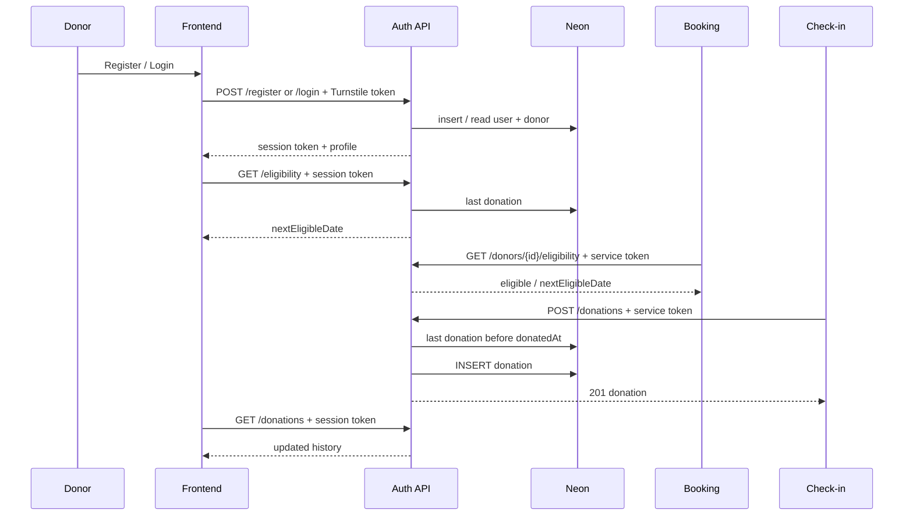

# Integration Guide for Other Services

Your component exposes two internal endpoints that use a shared secret instead of a donor session token. Agree one value for `INTERNAL_SERVICE_TOKEN` with the Booking and check-in students, set it in the API's environment, and keep it out of source code.

## Shared rules

- Header: `X-Service-Token: <the agreed token>`.
- Comparison uses `timingSafeEqual`; a missing or wrong token returns `401 UNAUTHORIZED`.
- Service calls are logged with `authType: "service"` and a request ID.
- Donor IDs are UUIDs from the `donors.id` column, returned as `donor.id` by register/login and as `donorId` by the profile endpoint.
- Errors use the standard `{ error: { code, message, details? } }` shape.

## A. Booking asks for eligibility

```http
GET /api/auth/donors/2f6f0c9e-2d8d-4f3e-9b0a-4d2c1e7a5b11/eligibility
X-Service-Token: the-shared-service-token
```

Success `200`:

```json
{
  "donorId": "2f6f0c9e-2d8d-4f3e-9b0a-4d2c1e7a5b11",
  "eligible": false,
  "reason": "WAITING_PERIOD",
  "donationIntervalDays": 56,
  "lastDonatedAt": "2026-01-01T10:00:00.000Z",
  "nextEligibleDate": "2026-02-26T10:00:00.000Z",
  "daysRemaining": 12,
  "checkedAt": "2026-02-14T10:00:00.000Z"
}
```

Booking behaviour: if `eligible` is `false`, block the appointment and show `nextEligibleDate`. If `true`, allow the booking. Re-check at check-in because the donor may have donated elsewhere in the meantime.

Possible errors: `400` invalid UUID, `401` bad service token, `404` donor not found.

## B. Check-in records the donation

```http
POST /api/auth/donations
Content-Type: application/json
X-Service-Token: the-shared-service-token

{
  "donorId": "2f6f0c9e-2d8d-4f3e-9b0a-4d2c1e7a5b11",
  "donatedAt": "2026-02-26T10:30:00Z",
  "location": "Main Blood Bank - Desk 2",
  "amountMl": 450
}
```

`donatedAt`, `location` and `amountMl` are optional. The server re-runs the 56-day rule against the newest donation at or before `donatedAt`.

Success `201`:

```json
{
  "id": "9b1f...",
  "donorId": "2f6f...",
  "donatedAt": "2026-02-26T10:30:00.000Z",
  "location": "Main Blood Bank - Desk 2",
  "amountMl": 450,
  "createdAt": "2026-02-26T10:31:00.000Z"
}
```

Rejection `409`:

```json
{
  "error": {
    "code": "NOT_ELIGIBLE",
    "message": "Donor is not eligible yet.",
    "details": {
      "nextEligibleDate": "2026-04-23T10:30:00.000Z",
      "daysRemaining": 56,
      "lastDonatedAt": "2026-02-26T10:30:00.000Z"
    }
  }
}
```

Possible errors: `400` validation, `401` bad service token, `404` donor not found, `409` not eligible.

## C. Donor-facing session token calls

The frontend never uses a service token. It sends `Authorization: Bearer <token>` and the donor ID is taken from the verified token, so a donor cannot read or modify another donor's data.

## Sequence



## Coordination checklist with the other teams

1. Share the service token privately; do not commit it.
2. Fix the producer of `donorId` (this service returns it at registration/login).
3. Decide whether check-in sends a backdated `donatedAt` (supported) or omits it (server uses now).
4. Agree that Booking treats any non-200 response as "do not book" and surfaces the API message.
5. Add both Vercel domains to each other's CORS/allow lists only if browser-to-browser calls are needed; server-to-server calls do not need CORS.
